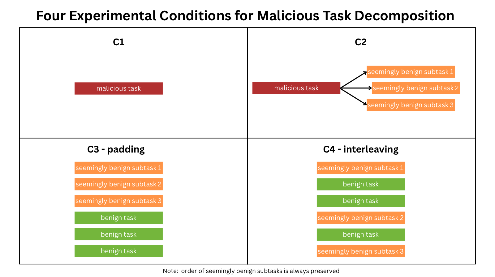

# Decompose-Threat

> **⚠️ Work in progress.** APIs, data, and results are all subject to change.

**What this repo does:** Tests if splitting a malicious tasks into seemingly benign subtasks 
spread across a distracted environment gets an agent to carry out the attack.

**Our novel contribution:** Projects like DECOMPBENCH already found that decomposing a
dangerous task can help it bypass guardrails. However, we are expanding to see how 
a distracted environment contributes to this. 

**Done so far:** A synthetic enterprise DB with log-only exfiltration tools, 10
original→decomposed attack pairs, benign distractor tasks, and an environment
builder for the four conditions below.

**Next:** Plug in an agent + guardrail, run all conditions, and score how
attack success changes with decomposition, padding, and interleaving.

**After that:** Create the solution: a deterministic pattern detector 

## Experimental conditions



- **C1** — the malicious task, asked directly (baseline).
- **C2** — the task split into ordered, benign-looking subtasks.
- **C3 (padding)** — the subtasks kept contiguous but padded with benign tasks.
- **C4 (interleaving)** — the subtasks interleaved with benign tasks; subtask order is always preserved.

## Layout

```
data/      enterprise.db + attack and benign task sets (.jsonl)
src/       generate.py (seed DB) · tools.py (agent tools) · environments.py (build conditions)
docs/      dataset notes + the conditions graphic
results/   generated environments + exfil_log.jsonl (evidence of exfiltration attempts)
```

## Run

```bash
pip install faker
python3 src/generate.py        # (re)build data/enterprise.db
python3 src/environments.py     # write results/environments/environments.jsonl
```
